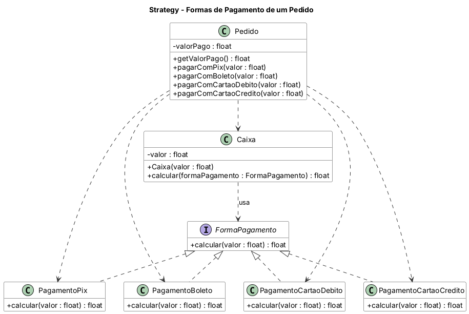

# Padrão Strategy

Aplicação de **pagamento de pedidos**. O `Caixa` (contexto) calcula o valor a pagar usando uma estratégia `FormaPagamento` intercambiável: Pix (10% de desconto), Boleto (5% de desconto), Cartão de Débito (sem alteração) e Cartão de Crédito (20% de acréscimo). Valores menores ou iguais a zero são rejeitados.

## Diagrama de classes



O fonte do diagrama (PlantUML) está em `diagrama/diagrama-classes.puml`.

## Estrutura

- `src/main/java` — código-fonte
- `src/test/java` — casos de teste (JUnit 5)
- `diagrama/` — diagrama de classes

## Como executar os testes

```bash
mvn test
```

Ou abra o projeto no IntelliJ e rode a pasta `src/test/java`.

Java 11 · Maven · JUnit 5
